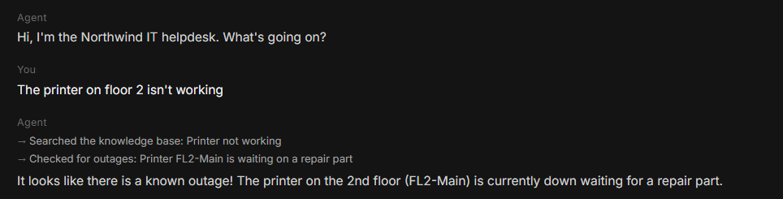

# IT Helpdesk Agent

An AI agent that troubleshoots common IT problems with employees of a fictional company, Northwind. It uses tools to look up fixes and check for outages, and when it can't solve the problem, it opens a support ticket for a technician.

**Try it live:** [jacobjohnson-ai.github.io](https://jacobjohnson-ai.github.io/#projects) (open "IT Helpdesk Agent")



## The problem

Most helpdesk requests are the same handful of issues: Wi-Fi, VPN, passwords, printers, email. Technicians spend time walking people through the same first steps. An agent can handle that first round, and when it can't fix something, it hands the technician a ticket that already says what was tried.

## How it works

1. An employee describes a problem in the chat.
2. The AI (Google Gemini) decides which tools to use. It can call:
   - **`search_kb`**: searches the IT knowledge base for fix steps
   - **`check_outages`**: checks the IT status page for known outages
   - **`create_ticket`**: opens a ticket for a technician
3. The agent runs the tools, reads the results, and decides the next step. The chat shows each tool it used.
4. Tickets are saved to the same Postgres database as my [Support Ticket Dashboard](https://github.com/jacobjohnson-ai/support-ticket-dashboard), so new tickets show up there.

| Tool | Used for |
|---|---|
| Google Gemini (function calling) | Decides what to do and which tool to call |
| Cloudflare Workers | Runs the agent and keeps the API keys server-side |
| Supabase (Postgres) | Stores tickets |
| JavaScript | The agent, the tests, and the chat page |

## Security

- **Keys never reach the browser.** The Gemini and database keys are encrypted secrets in Cloudflare. The website only talks to the Worker.
- **Only three tools exist.** The agent can't run anything else. An unknown tool request is refused (there's a test for it).
- **The AI's ticket data is validated** before it touches the database: urgency, score, and category are checked against allowed values, and text is trimmed to a safe length.
- **Least privilege on the database.** The server key can only insert and read tickets (`grant select, insert`), not edit or delete them.
- **Abuse limits.** Messages are capped at 600 characters, each visitor gets a few messages per minute and a few tickets per hour, and only my website's address can call the Worker.
- **Prompt injection.** The agent is told to treat user messages and tool results as data, not instructions, and not to make up phone numbers or contacts.
- **No personal data.** Tickets from the demo are saved without a real name or email.

## Tests

```
npm test
```

7 tests cover the knowledge base search, the outage check, ticket validation, request validation, the full agent loop (with the AI mocked), refusing unknown tools, and blocking requests from other websites.

## Files

| File | What it is |
|---|---|
| [`worker/worker.js`](worker/worker.js) | The agent: tools, prompt, agent loop, limits |
| [`test/agent.test.mjs`](test/agent.test.mjs) | Automated tests |
| [`site/helpdesk.html`](site/helpdesk.html) | The chat page on my website |

## Run it yourself

1. Create a Cloudflare Worker and paste in `worker/worker.js`.
2. Add three secrets: `GEMINI_API_KEY`, `SUPABASE_URL`, and `SUPABASE_SERVICE_KEY`.
3. Create the `tickets` table from the [dashboard project](https://github.com/jacobjohnson-ai/support-ticket-dashboard/blob/main/sql/01_create_table.sql), then run:
   ```sql
   grant select, insert on public.tickets to service_role;
   ```
4. Point `API` in `site/helpdesk.html` at your Worker and add your site to `ALLOWED_ORIGINS` in the Worker.
